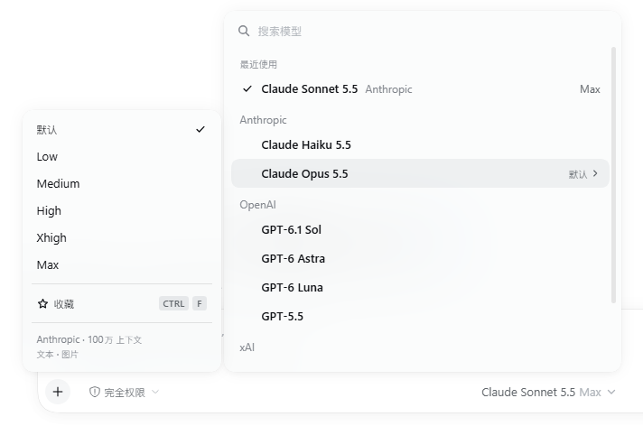

# dsh-model-effort-picker（本地插件）

三件事，一个插件：

1. **类 OpenCode 的模型选择器**：选模型的同时选思考强度，不用选两遍。
2. **每个模型记住上一次的思考强度**：切到某个模型就自动用它上次的强度，哪个入口切都生效。
3. **切换模型/强度时界面不再闪烁**。

## 用法



点输入框右下角的模型按钮：

- 顶部搜索框直接打字过滤，多个词用空格分开（模型名、模型 id、供应商都能搜）。
- 列表按 **收藏 → 最近使用 → 各供应商** 分组。
- **高亮**某个模型（鼠标悬停或方向键）时，右侧展开**它自己的**思考强度菜单：
  - 点强度 = 一步选好「这个模型 + 这个强度」；
  - 点模型行 = 这个模型 + 它上次用的强度（没用过就用模型默认值）。
- 键盘：`↑` `↓` 选模型，`→` 进入强度菜单，`Enter` 确定，`←` 回到列表，`Esc` 先退出强度菜单、再关闭，`Ctrl+F` 收藏/取消收藏。

强度菜单底部显示供应商、上下文长度和输入类型（从 DSH 的模型信息读取）。

### 动效

- 鼠标移到哪一行，高亮和右侧强度菜单**当场**跟过去，没有悬停延迟。
- 打开/关闭：菜单和强度菜单淡入淡出，带一点 `scaleY(.95)` 的缩放（入场 150ms、退场 110ms，曲线取自 OpenCode 的 `cubic-bezier(.25, 0, .5, 1)`）。退场期间菜单不响应鼠标，不会挡住下面的点击；退场时再次点开会直接接回，不闪。
- 高亮行背景快进（60ms）慢出（180ms）；换行时强度菜单顺滑滑到新行（120ms），列表滚动时则紧贴不滑。
- 系统开了「减少动态效果」时，以上动画全部关闭，关闭菜单立即卸载。

## 设置

「设置 → 通用设置」最下面有三个开关，默认都开：

| 开关 | 作用 |
|---|---|
| 类 OpenCode 模型选择器 | 关掉后立即恢复 DSH 原生选择器 |
| 记住每个模型的推理强度 | 关掉后切换模型不再自动套用上次强度（仍会记录） |
| 切换模型时不改写配置文件 | 见下文「为什么不再闪烁」 |

## 为什么不再闪烁

DSH 每次切换模型或强度，都会把你选的结果写回 profile 配置里的 `agent-default-model` 那一行（用来让新会话沿用上次的选择），并通知所有界面「设置变了」。你装的换肤插件（dsh-dream-skin）收到通知后，会把 `<body>` 上几百个 CSS 变量先清空再重设，带颜色过渡的元素（对话里的行内代码、侧边栏「新会话」按钮、侧边栏条目等）就会跟着闪一下。

本插件开着「切换模型时不改写配置文件」时，改为把「上一次的选择」记在插件自己的文件里：

- 新会话照样沿用上次的模型和强度；
- 配置文件不再被改写，也就没有这条通知，没有闪烁；
- **你手动改 `agent-default-model` 仍然优先**：每次记录时同时记下当时的配置，之后只要发现配置和那时不同，就以配置为准，下一次切换再重新记录；
- 关掉开关或卸载插件，DSH 回到原来的行为（原来的方法会被原样放回去）。

## 数据放在哪

`$DSH_HOME\dsh-model-effort-picker\state.json`（默认 `C:\Users\<你>\.dsh\dsh-model-effort-picker\state.json`）。

桌面端每次启动的网页端口可能不同，浏览器的 localStorage 会因此丢失，所以记忆以这个文件为准，localStorage 只做快速缓存。文件包含：每个模型上次的强度、最近使用、收藏、三个开关，以及上一次的默认选择。删掉它就等于清空记忆。

## 安装

```powershell
& 'D:\DSH\resources\runtime\cli\bin\dsh.cmd' plugin --profile desktop add "link:E:/WorkSpace/my-dsh-plugins/dsh-model-effort-picker"
```

这条命令会同时把依赖和 `dsh.profile.bundles` 条目写好。装完重启 DSH。

## 卸载

DSH「插件」页卸载，或：

```powershell
& 'D:\DSH\resources\runtime\cli\bin\dsh.cmd' plugin --profile desktop remove dsh-model-effort-picker
```

## 和别的插件一起用

- **`@ayanehana/dsh-reasoning-effort`（滑块）**：两者抢同一个输入框座位，本插件优先，滑块不会出现。想用滑块，先关掉「类 OpenCode 模型选择器」。
- 其它改模型的入口（`/model` 命令、原生选择器）不受影响，它们选的结果同样会被记住。
- 子智能体会话没有模型选择入口，本插件也不显示。

## 已知限制

- 同时开着多个浏览器窗口时，另一个窗口里「新会话默认显示的模型」要等它自己选一次或刷新页面才更新（原来的行为是 DSH 广播设置变更来刷新）。
- 「每个模型的强度记忆」是浏览器端逻辑；从 IM 等其它入口切换模型，上一次的默认选择会被记住，但不会按模型回填强度。

## 依赖的非公开细节（DSH 升级后可能需要调整）

在 DSH 0.2.1-rc.5 上开发和验证：

- 客户端：`modelDirectories` 服务里每个会话的 `ModelDirectory.select`、`live.directories`、`catalog.refresh()`；输入框座位 `conversation.input.model`。
- 服务端：`agentDefaultModel` 服务的 `currentSelection()` / `saveSelection()`。

任何一处失效时都会退回 DSH 原行为：座位渲染出错会被卡槽系统自动放弃、原生选择器接回；钩子装不上就保持原来的写配置方式。

## 测试

```powershell
cd E:\WorkSpace\my-dsh-plugins\dsh-model-effort-picker
& 'C:\Users\Admin\.dsh\dsh-runtimes\dsh-primary-runtime\dependencies\node\bin\node.exe' --test
```

125 个用例，覆盖状态规范化与合并、持久化（含写入失败、损坏文件）、HTTP 路由、默认模型钩子、选择器的搜索与分组、`select` 的补丁与恢复、组件装配、动效约束（无悬停延迟、退场不挡点击、减少动态效果）。

界面本身另外在真实 Chrome 里验证过：隔离的 DSH 实例（独立 `DSH_HOME` 和端口、本地假模型服务、你的完整插件组合和壁纸皮肤），逐帧采样切换模型前后元素的计算颜色，对照开关两种状态；并核对了请求实际发出的模型和强度。
